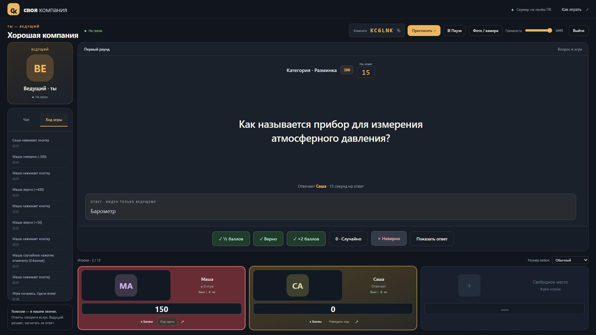

# Своя компания

Браузерная викторина для друзей по мотивам «Своей игры» и SIGame. **Сервер работает на ПК ведущего**, игроки открывают сайт по ссылке и вводят имя. Регистрация и отдельный игровой клиент не нужны.

Один ведущий, до **12 игроков**, комнаты по коду, готовый набор и импорт **`.siq`**. Для друзей из разных мест основной режим — общая сеть **Radmin VPN**, без Cloudflare и серверов SIGame. В одной домашней сети Radmin не требуется.

[Скачать для Windows](https://github.com/wexaaa/svoya-kompaniya/releases/latest) · [Запуск](#быстрый-запуск-на-windows) · [Исходники](#запуск-из-исходников) · [Финал](#финал)



## Что умеет игра

| Возможность | Как работает |
| --- | --- |
| Комнаты без регистрации | Приглашение по ссылке или коду; ведущий и до 12 игроков. |
| Вопросы | Встроенные 30 вопросов в 6 темах; загрузка SIQ 4/5 и библиотека `packs/`. |
| Текст и медиа | Изображения, аудио, видео, варианты и отдельные медиа правильного ответа. |
| Особые вопросы | Аукцион, «кот в мешке», вопросы без риска и скрытые ставки для всех. |
| Предзагрузка | Общая панель с прогрессом каждого участника; исчезает после готовности всех онлайн. |
| Этапы вопроса | Последовательный показ текста и медиа по длительности, окончанию записи или команде ведущего. |
| Число и точка | Ввод числа с допуском или выбор точки на изображении; оценка ведущим. |
| Отвечают все | Одновременные скрытые ответы, общая проверка и последовательный переход вопросов. |
| Быстрая кнопка | «Знаю ответ» или пробел; первое нажатие, принятое сервером, получает попытку. |
| Варианты ответа | Сначала кнопка, затем выбор карточки. Выбор передаётся ведущему и фиксируется. |
| Оценка | Обычная, половинная или двойная стоимость; ошибка; отмена случайного нажатия за 0 баллов. |
| Пасы | Отметки на карточках и список имён; когда попытки закончились у всех, открывается ответ. |
| Управление ведущего | Добавление/снятие баллов, точный счёт и передача выбора вопроса нужному игроку. |
| Таймеры | Время на кнопку, обычно 15 секунд на ответ (пакет может задать своё время), 60 секунд на ответ финала. |
| Возврат к табло | Через 5 секунд после верного ответа обычного раунда. |
| Общая пауза | Останавливает таймеры, медиа и игровые действия; чат остаётся доступен. |
| Общение | Текстовый чат комнаты и отдельная вкладка «Ход игры». |
| Профили | Аватар с редактором масштаба/кадрирования; VDO.Ninja, включая виртуальную камеру OBS. |
| Игровое поле | Карточки игроков снизу, ведущий слева; три размера вебок, широкие вопросы, крупное медиа финала. |
| Вертикальное видео | Почти на всю высоту окна, с доступными кнопками ответа; Esc сворачивает просмотр. |
| Звук | Личная громкость запоминается между вопросами. Паузой и перемоткой управляет ведущий. |
| Пинг | Ведущий видит задержку подключения каждого игрока. |
| Сохранение | Комнаты, счёт, профили, переписка и этап финала сохраняются на ПК ведущего. |

Голосовые ответы обсуждаются в вашем обычном звонке. В игре есть **текстовый чат**, встроенного голосового чата нет.

## Быстрый запуск на Windows

1. Откройте [последний релиз](https://github.com/wexaaa/svoya-kompaniya/releases/latest). В **Assets** скачайте **`Svoya-Kompaniya-Windows.zip`**.
2. Распакуйте **весь архив** в отдельную папку. В готовой сборке уже есть Node.js и зависимости.
3. Выберите режим запуска из таблицы ниже.
4. На ПК ведущего откройте **`http://localhost:3100`**.
5. Создайте комнату, выберите готовый набор или загрузите `.siq`.
6. Нажмите **«Пригласить»**, отправьте ссылку друзьям. Они вводят имя, ведущий нажимает **«Начать игру»**.

| Файл | Назначение |
| --- | --- |
| `START-RADMIN.cmd` | Общая сеть Radmin VPN; основной режим для друзей из разных мест. |
| `START-LOCAL.cmd` | Одна домашняя/локальная сеть. |
| `START-INTERNET.cmd` | Дополнительный Cloudflare Quick Tunnel. |
| `STOP-GAME.cmd` | Остановить сервер с сохранением комнат. |
| `ALLOW-RADMIN.cmd` | Разрешить подключения через адаптер Radmin; потребуется запрос администратора. |
| `REMOVE-RADMIN-ACCESS.cmd` | Удалить созданное для Radmin правило брандмауэра. |

ПК и окно запуска должны оставаться включёнными во время игры. Остановка также доступна через **Ctrl+C**. После обновления версии всем участникам следует обновить сайт через **Ctrl+F5**.

В **1.12.2** исправлен запуск `.cmd` после переключения консоли на UTF-8: старый `scripts/run-node.cmd` мог выдавать `is not recognized as an internal or external command` вместо запуска игры. Используйте исправленную Windows-сборку либо замените этот файл из актуальных исходников. Комнаты и пакеты находятся в `data/` и `packs/`; при обновлении сохраните эти папки.

### Через Radmin VPN

1. Все участники устанавливают [Radmin VPN](https://www.radmin-vpn.com/) и входят в **одну сеть**.
2. Ведущий запускает `START-RADMIN.cmd`. В окне появится адрес вида `http://26.x.x.x:3100`.
3. Ведущий открывает сайт через `localhost`, создаёт комнату и отправляет приглашение.
4. Друзья открывают приглашение в браузере, пока Radmin включён.

Проброс порта роутера и белый IP не нужны. Radmin обеспечивает виртуальную сеть между компьютерами, игровой сервер остаётся на ПК ведущего. Cloudflare в этом режиме не используется.

Если сайт у друга не открывается: проверьте общую сеть Radmin и доступность ПК ведущего, затем запустите `ALLOW-RADMIN.cmd` на ПК ведущего. Правило разрешает TCP-порт 3100 через адаптер Radmin для адресов `26.0.0.0/8`.

### В одной локальной сети

Запустите `START-LOCAL.cmd`. Ведущий использует `localhost`, друзья — адрес **«В вашей сети»** из окна запуска. Устройства должны иметь доступ к ПК ведущего по этой сети.

### Дополнительный интернет-туннель

`START-INTERNET.cmd` использует `runtime/cloudflared.exe` из Windows-сборки. Адрес меняется при новом запуске. Доступность зависит от Cloudflare и сети участников; если туннель не работает, используйте Radmin или локальную сеть.

## Как играть

1. Ведущий или назначенный игрок выбирает тему и стоимость.
2. **«Знаю ответ»** или **пробел** заявляет игрока на ответ. Кнопка доступна сразу после открытия вопроса.
3. На обычный ответ даётся **15 секунд**. Если есть варианты, отвечающий игрок нажимает карточку. После отправки варианта таймер останавливается до оценки; изменить вариант нельзя.
4. Ведущий оценивает ответ:

| Кнопка | Результат |
| --- | --- |
| **✓ Верно** | Прибавить стоимость вопроса. |
| **✓ ½ баллов** | Прибавить половину стоимости, округляя до целого. |
| **✓ ×2 баллов** | Прибавить двойную стоимость. |
| **× Неверно** | Снять стоимость при включённом штрафе; закрыть повторную попытку игрока. |
| **0 · Случайно** | Отменить нажатие без изменения счёта; игрок снова может отвечать. |

После верного ответа право выбора переходит ответившему игроку. Ответ показывается **5 секунд**, затем игра возвращается к табло.

**«Пас»** не снимает очки, но закрывает попытку на текущем вопросе. Пока отвечает другой игрок, пас недоступен. Когда все участники вопроса спасовали или использовали попытку, открываются правильный ответ и его медиа; затем ведущий возвращает игру к табло. Присоединившийся посреди вопроса игрок участвует со следующего вопроса.

Время на кнопку в лобби: **10, 20, 30 или 60 секунд**. Для аудио/видео отсчёт начинается после окончания всех медиа вопроса, хотя отвечать можно и во время воспроизведения.

### Дополнительное управление ведущего

- **± Баллы** на карточке: добавить, снять или установить точный счёт.
- **Передать ход**: назначить выбирающего вопрос в лобби, на табло или при раскрытом ответе.
- **Показать ответ**, возврат к табло, следующий раунд, завершение игры.
- **Пауза / Продолжить**: сохранить оставшееся время и позиции медиа, включая финал и отсчёт до табло.
- После ошибки карточка игрока подсвечивается красным на секунду.

## Финал

Финальный раунд определяется по типу `final` в SIQ либо по названию «Финал» у последнего раунда старого пакета. В каждой теме должен быть один вопрос.

1. Игроки по очереди убирают темы. Первым ходит участник с наименьшим счётом; затем очередь идёт по кругу. Ведущий может удалить тему за игрока.
2. Когда остаётся одна тема, каждый делает **скрытую ставку** от 0 до своего счёта. При нулевом или отрицательном счёте — ставка 0. Ставки закрыты даже от ведущего до проверки.
3. Открывается вопрос. Ведущий запускает **60 секунд на письменные ответы**.
4. Игроки отправляют ответы через отдельное поле. Отправленный ответ не меняется и до проверки скрыт от остальных игроков.
5. Когда все ответили, время вышло или ведущий завершил приём, открывается проверка. Ведущий сравнивает ответы с правильным, оценивает каждого и публикует результат.
6. За верный ответ прибавляется ставка, за ошибку — вычитается. Очки начисляются один раз при публикации; затем всем видны ставки, ответы и итоговый счёт.

Во время финала вход новых игроков и обычная правка счёта отключены. Ведущий может завершить приём ставок и ответов за отсутствующих участников. Этап финала сохраняется при перезапуске.

## Медиа, аватары и камеры

Медиа вопроса и раскрытого ответа запускаются автоматически. **Паузой и перемоткой управляет ведущий**; игроки меняют только личную громкость. Если браузер блокирует звук, один раз нажмите **«Разрешить звук»**.

Громкость сохраняется между вопросами и после обновления страницы. Вертикальные видео увеличиваются почти на всю высоту окна; **Esc** или **«Свернуть видео»** возвращают обычный вид. Повторное увеличение не перезапускает ролик.

### Фото и VDO.Ninja

1. Нажмите **«Фото / камера»**.
2. Для аватара загрузите JPG, PNG или WebP до 12 МБ. Выберите масштаб и видимую область в редакторе, сохраните.
3. Для камеры нажмите **«Создать трансляцию»**, выберите обычную или виртуальную камеру и запустите её на [VDO.Ninja](https://vdo.ninja/). Для OBS сначала включите OBS Virtual Camera.
4. Вернитесь в игру и сохраните профиль. Вкладку отправки видео держите открытой.

Для готовой трансляции вставьте ссылку **просмотра с `?view=`**, включая пароль. Ссылка отправки с `?push=` не подходит. Камеры показываются без звука; для VDO.Ninja нужен интернет. Размер карточек меняется над игроками и запоминается отдельно в каждом браузере.

## Пакеты `.siq`

В проект входит собственный набор **«Хорошая компания»**: 30 вопросов, 6 тем. Пользовательские пакеты и их медиа в публичную поставку не входят.

В папке [packs](packs/README.md) также опубликованы два собственных тестовых пака: **«Тест новых функций»** на 28 вопросов и **«Тест режима Отвечают все»** на 6 вопросов. [Инструкция с ответами](<packs/Как проверять новые функции.md>) описывает ожидаемое поведение каждого вопроса. Все тестовые медиа находятся внутри паков.

- Загрузите `.siq` через лобби или скопируйте файл в `packs/`, чтобы он появился в библиотеке после обновления страницы.
- SIQ 4/5: текст, варианты, изображения, аудио/видео и отдельные медиа ответа.
- Максимум: загрузка **512 МБ**, распаковка **1 ГБ**, один файл **256 МБ**, **1500 вопросов**.
- Пакеты больше 100 МБ удобнее загружать через `localhost` на ПК ведущего.

Поддерживаются аукционы (`stake` / `auction`), «коты» (`secret` / `cat` / `bagcat`, включая открытую стоимость и кота без вопроса), вопросы без риска (`noRisk` / `sponsored`), вопросы для всех (`forAll`) и скрытые ставки для всех (`stakeAll`). Для проверки выберите в библиотеке **«Новые механики · пробный набор»**: в нём есть примеры новых правил, ответ числом, точка на картинке и вопрос из трёх этапов.

HTML-мини-игры и произвольные пользовательские скрипты SI не исполняются; импорт сообщает о неподдерживаемом содержимом. Последовательность стандартных элементов содержимого поддерживается. Кодеки аудио/видео должны поддерживаться браузером; внешним медиа требуется доступ к их источникам.

### Новые механики в версии 1.12

- **Аукцион.** Игроки по очереди повышают ставку или пасуют. Минимум первого предложения — номинальная цена вопроса; предел — свой счёт либо номинал, если счёт ниже. Доступна кнопка «Ва-банк». Победитель отвечает один, начисление или штраф равны итоговой ставке. Ведущий может поставить или спасовать за текущего игрока.
- **Кот в мешке.** Открывший вопрос выбирает получателя с учётом ограничений пакета. Получатель выбирает стоимость из диапазона пакета и отвечает один. Ведущий может выполнить выбор за игрока. Кот без вопроса сразу начисляет выбранные баллы.
- **Без риска.** Отвечает выбравший вопрос игрок; ошибка не отнимает баллы даже при включённых штрафах. Если вопрос открывает ведущий, получателем становится игрок с ходом или первый участник.
- **Предзагрузка по раундам.** Картинки, музыка и видео загружаются заранее. Все подключённые участники видят прогресс ведущего и игроков: проценты и число файлов. Панель автоматически исчезает, когда все участники онлайн загрузили все файлы; при подключении нового участника появляется снова до его готовности. Отключённые участники не задерживают завершение. Ошибки остаются видны, есть повтор загрузки. Это информационная панель: ведущий может начать игру до окончания загрузки.
- **Несколько этапов.** Порядок элементов из SIQ 4/5 сохраняется. После аудио/видео с ожиданием завершения или заданной длительности открывается следующий этап. Статичный этап без времени переключает ведущий кнопкой «Следующий этап». На каждом шаге виден его номер. Пауза останавливает также время показа этапа. Отвечать в обычном режиме можно сразу.
- **Число и точка.** В обычной игре сначала нажмите «Знаю ответ». Затем введите число (допустима десятичная запятая) либо выберите точку на изображении и подтвердите отправку. До отправки точку можно менять. Ведущий видит ответ и подсказку о попадании в допуск пакета; окончательную оценку даёт ведущий. Координаты относятся к самому изображению, а не к полям вокруг него.
- **Голосовой или написанный ответ.** В обычном вопросе поле ответа необязательно: после «Знаю ответ» можно ответить голосом в Discord, а ведущий сразу ставит оценку без заполнения поля. По желанию можно отправить текст, число или точку через сайт. Написанный ответ появляется поверх аватарки или вебки; в обычном раунде его видят все. После возврата к табло или отмены случайного нажатия ответ с карточки убирается. В режиме «Отвечают все» и финале чужие ответы на карточках скрыты до проверки ведущим или публикации результатов, как и сами ответы.
- **Нижняя панель стоимости.** В аукционе и у всех вариантов «кота», включая кота без вопроса, стоимость выбирается ползунком внизу поля либо вводится вручную. Диапазон и шаг берутся из правил вопроса; если разрешена единственная сумма, ползунок неподвижен, но подтверждение суммы доступно.
- **«Отвечают все».** В лобби выберите режим «Отвечают все · по порядку». Вопросы идут последовательно, участники отправляют текст, число, вариант или точку одновременно. Нажимать кнопку ответа не требуется. До окончания приёма ответы скрыты от остальных и ведущего. После отправки всех ответов, окончания таймера или команды ведущего открывается проверка. Для чисел, точек и вариантов подставляется оценка по данным пакета; ведущий может изменить её. Баллы начисляются всем одновременно по кнопке «Начислить баллы». Пас или отсутствие ответа дают 0, ошибка при включённом штрафе отнимает цену вопроса. Через 5 секунд после публикации начинается следующий вопрос. Особые вопросы сохраняют собственные правила; финал проводится со ставками.
- **Вопросы `forAll` / `stakeAll` из пакета** включают одновременные ответы и в обычном режиме. В `stakeAll` перед показом вопроса каждый делает скрытую ставку в пределах своего положительного счёта.

Предзагрузка использует HTTP-кеш браузера и ограниченный кеш аудио/видео в памяти (до 256 МБ). Доступны обычные HTTP-адреса локальной сети и Radmin, HTTPS не обязателен. Внешний сервер медиа должен разрешать загрузку из браузера (CORS); недоступный файл будет отмечен ошибкой, вопрос можно продолжить играть. Громкость остаётся личной настройкой, воспроизведением управляет ведущий.

**Пакет, импортированный до обновления, нужно выбрать или загрузить заново в лобби:** старые сохранения содержат уже упрощённые вопросы без исходных типов и этапов. Счёт и комнаты сохраняются; для новой партии можно создать отдельную комнату.

## Сохранение и возвращение игроков

Данные комнат хранятся на сервере в **`data/`**: счёт, профили, сообщения, этап финала, медиа и ключи участников. После обновления страницы игрок возвращается на своё место, если использует тот же браузер и адрес сайта.

Если игрок сменил браузер или адрес, ведущий нажимает **↗ на его карточке** и отправляет ему личную ссылку возвращения. Счёт сохраняется, новый участник не создаётся.

При обновлении Windows-сборки сохраните `data/` и свои пакеты из `packs/`. Для резервной копии остановите игру и скопируйте эти папки. Данные комнат в репозиторий и чистый релиз не включаются: в них находятся ключи ведущего и игроков. Лимит — **40 сохранённых комнат**.

## Запуск из исходников

Нужен **Node.js 22 или новее** с npm. Сборка интерфейса не требуется.

```bash
git clone https://github.com/wexaaa/svoya-kompaniya.git
cd svoya-kompaniya
npm ci
npm start
```

Откройте `http://localhost:3100`.

```bash
npm run start:radmin
npm run start:local
npm run start:internet
```

Radmin-режим требует включённого адаптера Radmin VPN. Для `start:internet` нужен cloudflared в `runtime/`; Windows-сборка уже содержит его. Файлы `.cmd` сначала используют встроенный `runtime/node.exe`, а при его отсутствии — установленный Node.js.

### Настройки сервера

| Переменная | По умолчанию | Назначение |
| --- | --- | --- |
| `PORT` | `3100` | Порт HTTP и WebSocket. |
| `HOST` | `0.0.0.0` | Интерфейс прослушивания. |
| `DATA_DIR` | `data/` рядом с сервером | Путь к сохранениям. |
| `PUBLIC_URL` | Не задан | Адрес приглашений при запуске сервера за своим прокси. |
| `SHARE_MODE` | `local` | Режим определения адреса: `local` или `radmin`; launcher выбирает автоматически. |

Пример PowerShell:

```powershell
$env:PORT = '3200'
node server.mjs
```

При смене порта правило брандмауэра тоже должно соответствовать новому порту. Свой обратный прокси должен поддерживать **WebSocket**.

### Проверки

```bash
npm test
```

В текущей версии **81 проверка**: игровые правила и права ведущего, ставки, начисление баллов, пасы, таймеры, пауза, чат, финал, приватность и отображение ответов, SIQ, предзагрузка, диапазонные запросы медиа, реальные WebSocket-клиенты и восстановление с диска. Запуск Windows-скриптов проверяется в UTF-8-консоли, с LF и CRLF, в пути с русскими буквами и пробелами, со встроенным и установленным Node.js. CI запускает проверки на Windows с Node.js 22 и 24.

## Структура проекта

```text
server.mjs          HTTP/WebSocket, API, сохранение и файлы
launcher.mjs        запуск, адреса, Radmin и дополнительный туннель
lib/game.mjs        обычные раунды, попытки, баллы и переходы
lib/final.mjs       темы, ставки, письменные ответы и проверка финала
lib/siq.mjs         импорт SIQ
lib/playback.mjs    синхронное воспроизведение
lib/room-tools.mjs  чат и пауза
lib/network.mjs    локальные адреса и Radmin
public/            интерфейс, профили, камеры, увеличенный просмотр
scripts/           правило брандмауэра для Windows
test/              автоматические проверки
packs/             локальные пакеты; SIQ не коммитятся
data/              сохранения; создаётся автоматически
runtime/           среда Windows-сборки; отсутствует в Git
```

Это самостоятельная игра, а не официальный клиент или полная копия SIGame. Сторонние компоненты и их лицензии перечислены в [THIRD_PARTY_NOTICES.md](THIRD_PARTY_NOTICES.md).
